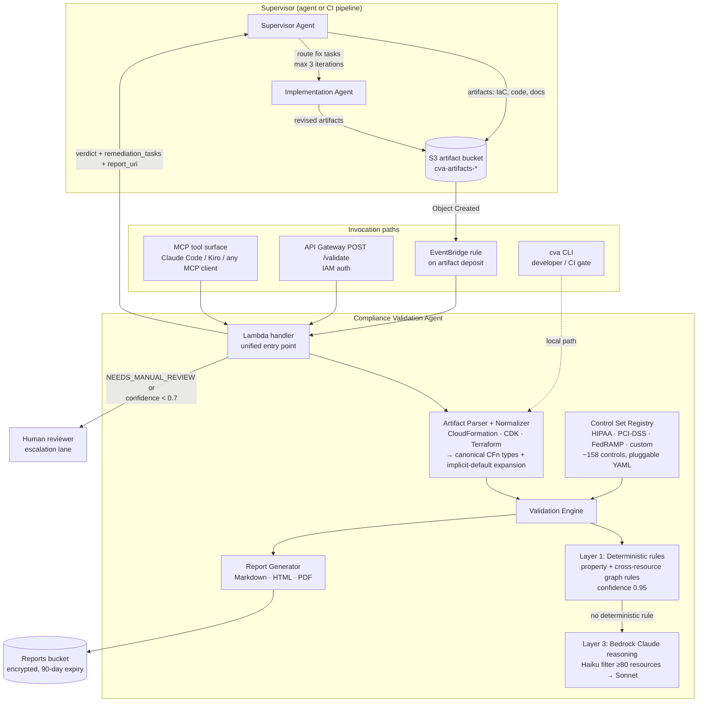
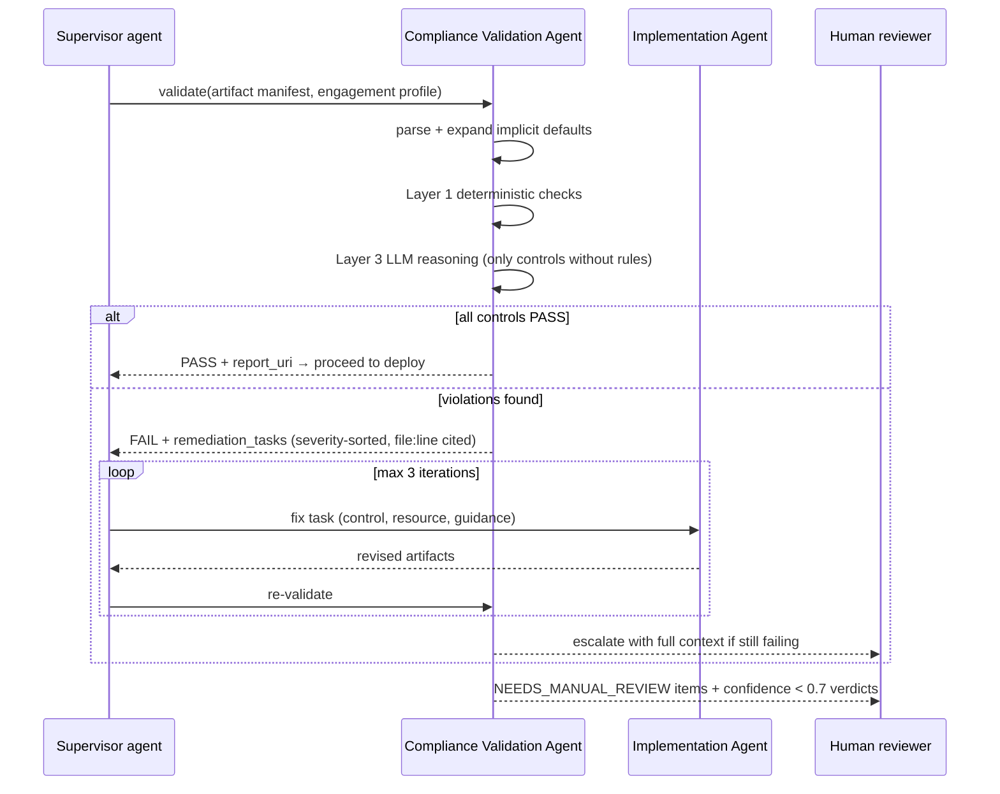

# Compliance Validation Agent (CVA)

An autonomous IaC compliance gate. CVA validates infrastructure-as-code (CloudFormation, CDK, Terraform) against regulatory frameworks (HIPAA, PCI-DSS, FedRAMP, or your organization's own policies) and returns evidence-cited, confidence-scored verdicts with prioritized remediation tasks — usable as a CI/CD gate, an API, an MCP tool for agentic coding assistants, or a worker agent inside a supervisor-driven fix → re-validate loop, with human escalation only where automated evidence is insufficient.

See [SECURITY-CONSIDERATIONS.md](SECURITY-CONSIDERATIONS.md) for AWS Well-Architected Agentic AI Lens
alignment, including the known gaps.

## What it does

1. **Parses** IaC — CloudFormation, synthesized CDK, and Terraform (HCL or plan JSON) — into one normalized resource graph, expanding implicit AWS defaults (an S3 bucket with no `PublicAccessBlockConfiguration` is treated as explicitly unprotected — violations can't hide in absent config). All formats normalize to canonical CloudFormation resource types, so one control set validates every dialect.
2. **Validates** every applicable control through a layered engine:
   - **Layer 1 — deterministic rules** (fast, confidence 0.95): property checks against pluggable YAML control sets, including **cross-resource ("graph") rules** that follow references between resources — e.g. "this database is encrypted, but it's reachable from `0.0.0.0/0` through its security group," a violation no single-resource check can see.
   - **Layer 3 — LLM reasoning** (Bedrock Claude): only for controls with no deterministic rule. Templates with ≥80 resources are pre-filtered by Claude Haiku before Sonnet reasons.
3. **Reports** in Markdown/HTML/PDF with per-control evidence chains, file:line citations, confidence scores, and remediation guidance.
4. **Returns a machine-readable contract** (verdict + prioritized remediation tasks + report URI) so a supervisor agent can route failures back to implementation for self-correction.

Verdicts: `PASS` | `FAIL` | `PARTIAL` | `NEEDS_MANUAL_REVIEW` | `NOT_APPLICABLE`.

## Architecture

CVA can run standalone (CLI / CI gate) or as a worker agent inside a supervisor-worker loop:
a supervisor agent invokes it as a pre-delivery gate, routes its `remediation_tasks` to an implementation
agent, and re-invokes it to confirm the fix.



### Agent flow — the self-correction loop



## Setup

Requires Python ≥ 3.9.

```bash
git clone https://github.com/aws-samples/sample-iac-compliance-validation-agent.git
cd sample-iac-compliance-validation-agent
pip install -e ".[dev]"     # includes python-hcl2 for Terraform HCL parsing
pytest                      # 90 tests
```

Terraform HCL parsing needs `python-hcl2` (bundled in the `dev` and `terraform` extras). Terraform plan JSON and all other formats need no extra dependency.

### Supported artifact formats

| Format | Input | Detection |
|---|---|---|
| CloudFormation | YAML/JSON template | default; `Resources:` block |
| CDK (synthesized) | `cdk.out/*.template.json` | path/extension or `AWS::CDK::Metadata` marker |
| Terraform | `.tf` HCL, `.tf.json`, or `terraform show -json` | extension, `resource "..."`, or plan JSON keys |

Override auto-detection with `--type {cloudformation,cdk,terraform}`.

## Usage

### CLI (developer / CI workflow)

```bash
# Validate templates against one or more frameworks (format auto-detected per file)
cva validate template.yaml -f hipaa -f pci-dss

# Terraform (HCL) and synthesized CDK work the same way
cva validate main.tf -f hipaa
cva validate cdk.out/MyStack.template.json -f pci-dss
cva validate plan.json --type terraform -f fedramp   # terraform show -json output

# HTML / PDF report
cva validate template.yaml -f hipaa --format pdf -o report.pdf

# Enable Bedrock LLM reasoning for controls without deterministic rules
cva validate template.yaml -f hipaa --semantic --region us-east-1

# List available frameworks
cva list-frameworks

# Convert your organization's policy document (.pdf/.docx/.txt/.csv) into executable controls
cva ingest customer-security-policy.pdf --name anycompany
cva validate template.yaml -f anycompany
```

Exit code is non-zero on `FAIL`, so `cva validate` works as a CI/CD gate.

### Lambda / API

Direct or API Gateway invocation:

```json
{
  "engagement_id": "ENG-12345",
  "frameworks": ["hipaa", "pci-dss"],
  "enable_semantic": true,
  "templates": [{"name": "main.yaml", "content": "..."}]
}
```

Response includes `overall_verdict`, per-control results, `report_uri` (S3), and `remediation_tasks` — self-contained work items (control, severity, affected resources with file:line, fix guidance) a supervisor agent can route to an implementation agent.

EventBridge mode triggers automatically when templates land in `cva-artifacts-*` buckets.

### MCP (agentic coding assistants)

CVA exposes `validate_compliance` and `list_frameworks` as MCP tools so any MCP client (Claude Code, Kiro, Cursor, or a custom supervisor agent) can validate artifacts in-loop and self-correct on the returned remediation tasks — the same contract as the Lambda/API path.

```bash
pip install -e ".[mcp,terraform]"    # requires Python >= 3.10
cva-mcp                              # serves over stdio
```

Register it with your MCP client (e.g. Kiro's `.kiro/settings/mcp.json` — drop-in [config](docs/mcp/kiro-settings-mcp.json)), or install the [Claude Code plugin](integration/claude-code-plugin/) which bundles the server, a `compliance-validator` sub-agent, and a `compliance-gate` skill. Full integration guide and self-correction loop: [docs/mcp/README.md](docs/mcp/README.md).

### Deploy (CDK)

```bash
cd infra
python3 -m venv .venv && source .venv/bin/activate
pip install -r requirements.txt
cdk deploy -c enable_semantic=true -c artifact_buckets=my-artifacts-bucket
```

Deploys: Lambda, IAM-authed REST API (`POST /validate`), EventBridge rule, and an encrypted reports bucket.

| Context flag | Effect |
|---|---|
| `enable_semantic=true` | Grants `bedrock:InvokeModel` on the pinned model ARNs. Omit it and the execution role has no Bedrock permission at all. |
| `artifact_buckets=a,b` | Scopes artifact reads to named buckets. **Recommended.** Omit it and the role falls back to the `cva-*` name prefix within this account only — CDK emits a synth-time warning saying so. |

## Control sets

Frameworks are pluggable YAML under `control_sets/<framework>/` — no engine changes needed to add one:

| Framework | Controls |
|---|---|
| HIPAA Security Rule | 40 |
| PCI-DSS v4.0 | 39 |
| FedRAMP Moderate | 41 |
| anycompany-financial (example ingested from a fictional company policy) | 38 |

Each control declares severity, applicable resource types, required properties (`$equals`, `$in`, `$not_equals`, `$contains`, `$gte`, `$not_none`), anti-patterns, evidence requirements, and remediation guidance.

**Cross-resource rules** use `check_type: relationship` to follow references (`traverse: {via, to}`) and assert over the referenced resources (`none_match` / `any_match`), with `[*]` wildcard element matching. Property paths and references resolve across CloudFormation, CDK, and Terraform alike.

## Security considerations

- **No auto-PASS without proof:** confidence below 0.7 escalates a permissive verdict to `NEEDS_MANUAL_REVIEW`, and `CRITICAL`/`HIGH` controls are never auto-passed on model reasoning alone. Any control left for a human caps `overall_verdict` at `PARTIAL` — an unreviewed control is not a passing control.
- **Prompt-injection containment:** resource properties are JSON-serialised into prompts, the model's response must fit a fixed JSON envelope, and confidence is clamped server-side. The real control is consequence-bounding: an injected `PASS` on a severe control is discarded by the severity gate. Free-text artifact sections are *not* fenced or sanitised — see [SECURITY-CONSIDERATIONS.md](SECURITY-CONSIDERATIONS.md) for the gap.
- **Least privilege:** the deployed Lambda's Bedrock access is scoped to specific model ARNs; S3 access is scoped to named buckets (or the `cva-*` prefix); API is IAM-authed and throttled.
- **Data handling:** reports bucket is encrypted with public access blocked and 90-day lifecycle expiry. A deterministic-only mode (`--no-semantic`, the default) avoids sending any customer content to an LLM.
- **Auditability:** every report — Markdown, HTML, and PDF — states that the assessment is AI-assisted and not a substitute for certified auditor review, and stamps the validation layers and Bedrock model IDs that produced it.

### AWS Well-Architected Agentic AI Lens alignment

CVA is itself an autonomous agent acting on customer artifacts, so it is designed against the
[Agentic AI Lens](https://docs.aws.amazon.com/wellarchitected/latest/agentic-ai-lens/agentic-ai-lens.html).
Mapping to the Lens's best practices:

| Lens best practice | How CVA implements it |
|---|---|
| **AGENTSEC04** — guardrails + human-in-the-loop for critical decisions | Confidence < 0.7 escalates a permissive verdict to `NEEDS_MANUAL_REVIEW`; `CRITICAL`/`HIGH` controls are never auto-passed on LLM reasoning alone. Both gates are enforced in one place — `engine._apply_safety_invariants` (`src/cva/validators/engine.py:128`) — and any control left for a human caps `overall_verdict` at `PARTIAL`. Procedural controls route to a human lane by design, not by failure. |
| **AGENTSEC08** — validate inputs, filter outputs | Outputs are tightly filtered: the model must return a fixed JSON envelope, verdicts are constrained to a closed set (`PASS`/`FAIL`/`PARTIAL`/`NEEDS_MANUAL_REVIEW`/`NOT_APPLICABLE`) with unknown values mapped to `PARTIAL`, and confidence is clamped server-side. Inputs are only partially validated — resource properties are JSON-serialised, but free-text artifact sections are interpolated unfenced. **Partially met**; see [SECURITY-CONSIDERATIONS.md](SECURITY-CONSIDERATIONS.md). |
| **AGENTSEC03** — agent identity + least-privilege access | API Gateway is IAM-authed and throttled (10 rps / 20 burst). The Lambda role can invoke only named Bedrock inference-profile and foundation-model ARNs (no wildcards), read only named artifact buckets (or `cva-*`), and write only the reports bucket. |
| **AGENTREL02** — atomic tasks, clear instruction protocols | Each `remediation_tasks[]` entry is a self-contained fix instruction: control ID, severity, guidance, and affected resources with `source_file` + `source_line`. A downstream implementation agent needs no additional context. |
| **AGENTOPS05** — tracing, auditability, explainability | Every verdict carries an evidence chain, the validation layer that produced it, a confidence score, and file:line citations. Reports stamp the model IDs used and carry an AI-assisted disclaimer, so any run can be reconstructed. |
| **AGENTPERF02** / **AGENTCOST02** — cognitive pipeline and model right-sizing | Layer 1 deterministic rules resolve most controls with zero inference. Bedrock runs only on controls with no deterministic rule; templates with ≥80 resources are pre-filtered by Claude Haiku before Claude Sonnet reasons. |
| **AGENTCOST01** — bound reasoning-loop cost | The fix → re-validate loop is capped at 3 iterations, then escalates to a human with full context, so a non-converging agent cannot spin indefinitely. |
| **Bounded autonomy** (responsible agentic AI) | Verdict semantics are a load-bearing contract: `FAIL` blocks delivery, `PARTIAL` requires human sign-off, and supervisors are explicitly forbidden from suppressing or downgrading a `CRITICAL`/`HIGH` failure. See [AGENTS.md](AGENTS.md). |
| **Data protection** | Deterministic-only is the default: no customer artifact reaches an LLM unless semantic mode is explicitly opted into (`--semantic` / `enable_semantic`). Reports bucket is SSE-encrypted, public access blocked, 90-day lifecycle expiry. |
| **Bias awareness and mitigation** (responsible agentic AI) | For a compliance validator, bias means *which customers get a weaker assessment than they think they got*. Four biases are identified and their mitigations stated honestly — coverage bias (a resource type no control targets is silently unevaluated: a real, empirically verified gap), model familiarity bias on rare or recent services (bounded by the severity gate and confidence floor, not removed), policy-ingestion bias toward mainstream English compliance idiom, and authored-severity bias (auditable because severities live in reviewable YAML). CVA is also *deliberately* biased toward over-reporting: false FAILs cost review time, a false PASS ships a non-compliant deliverable. Full analysis: [SECURITY-CONSIDERATIONS.md](SECURITY-CONSIDERATIONS.md#fairness-and-bias). |

**Known gaps** (honest scoping for a reference implementation). The most material: the reports
bucket has no per-engagement isolation or customer-managed KMS key, so it is not ready for a
multi-engagement deployment; Bedrock Guardrails are not configured and free-text artifact
sections are not sanitised (**AGENTSEC06**); and Layer 3 never cross-checks Layer 1, so an
incorrect control rule yields a confident wrong verdict that the severity gate cannot catch.
And there is **no coverage reporting**: a resource whose type no control targets is silently
never evaluated, so a customer on a less-common architecture gets a thinner assessment with
identical presentation. Beyond those: no operational dashboards or alarms (**AGENTOPS05** is
satisfied at the report/evidence level, not the telemetry level), no LLM-as-judge evaluation
harness (**AGENTOPS06**), and no Bedrock retry/backoff. All nine are enumerated with
consequences and status in **[SECURITY-CONSIDERATIONS.md](SECURITY-CONSIDERATIONS.md)**.

## Business impact

**The bottleneck CVA removes.** On a regulated workload, IaC — whether written by hand or generated by an AI agent — can be produced in minutes, but it cannot ship until a reviewer has checked it against the applicable framework and can *cite evidence* for each control. That review is the serial human step that caps delivery throughput.

**Measured on this repo's own sample** (`samples/network-exposure.yaml`, 6 resources, validated against HIPAA + PCI-DSS + FedRAMP — reproduce with `cva validate samples/network-exposure.yaml -f hipaa -f pci-dss -f fedramp`):

| | Result |
|---|---|
| Controls evaluated | **123** across three frameworks |
| Resolved automatically with cited evidence | **85 (69%)** |
| Routed to the human lane (`NEEDS_MANUAL_REVIEW`) | **38 (31%)** — procedural/non-IaC controls and low-confidence verdicts |
| Wall-clock, deterministic-only, no inference cost | **0.36 s** |
| Violations found with `file:line` citations | 13 `FAIL` + 13 `PARTIAL` |

The 31% is the honest number and the point of the design: CVA does not claim to replace the reviewer, it shrinks what the reviewer must personally evaluate by roughly two-thirds and hands them a pre-cited evidence chain for the rest. Assuming 2–4 minutes per control to locate and cite evidence by hand, a 123-control review is ~4–8 hours of reviewer time per iteration; CVA returns the same coverage in under a second and leaves ~1.5–2.5 hours of genuinely human judgment. **That saving recurs on every re-validation cycle** — which is exactly what makes an autonomous fix → re-validate loop affordable at all, since a loop that costs 4 hours per turn is not a loop anyone runs three times.

**Reusable compliance library.** The control sets are declarative YAML with no engine coupling, and `cva ingest` converts an organization's own policy document (`.pdf/.docx/.txt/.csv`) into executable controls — so the asset that accrues is a reusable, reviewable compliance library, not a one-off script. Three regulated frameworks plus a worked customer-policy example ship today; a fourth costs a `metadata.yaml` and control files, reviewable by a compliance specialist who does not read Python. Because CVA is exposed as an MCP tool, a CLI, a Lambda, and an API, the same library serves an agent loop, a developer's laptop, and a CI/CD gate (`cva validate` exits non-zero on `FAIL`) without a second implementation.

## Scalability plan

**What holds today.** Validation is stateless and per-request: the Lambda handler is the single entry point for direct invoke, API Gateway, EventBridge, and MCP, so horizontal scale is Lambda concurrency and needs no coordination. Layer 1 is pure in-process evaluation over a normalized resource graph — 123 controls in 0.36 s — so the deterministic path scales with template size, not with framework count. Cost scales sub-linearly by construction: Layer 1 costs no inference, Bedrock is consulted only for controls with *no* deterministic rule, and above 80 resources Claude Haiku pre-filters relevant resources before Sonnet reasons, so the expensive model never sees a full large template. API Gateway is throttled at 10 rps / 20 burst and both methods are IAM-authed.

**What has to change to run this across many teams or customers**, in the order it would bite:

| Scaling dimension | Current state | Required change |
|---|---|---|
| **Multi-engagement isolation** | One reports bucket, guarded only by account IAM | Per-engagement prefix isolation + a customer-managed KMS key with a restricted key policy. This is the **hard blocker** — findings from different tenants must not be co-readable (gap 1 in [SECURITY-CONSIDERATIONS.md](SECURITY-CONSIDERATIONS.md)). |
| **Large artifact sets** | Whole template set held in memory for one Lambda invocation | Shard by template across parallel invocations and aggregate verdicts; Lambda's 15-minute ceiling and memory bound the current design to engagement-sized artifact sets, not estate-wide scans. |
| **Bedrock throughput** | No retry/backoff; a throttled control degrades to `NEEDS_MANUAL_REVIEW` | Exponential backoff, and provisioned throughput or a queue once concurrent semantic runs are routine — otherwise scale converts throttling into human review work (gap 5). |
| **Control-set growth** | Frameworks loaded from YAML per invocation | Cache parsed control sets; at a few hundred frameworks, index by resource type so a control set is only loaded when a matching resource is present. |
| **Safety-invariant observability** | Verified by tests, not watched in production | CloudWatch metrics on gate activations, auto-PASS rate, and `NEEDS_MANUAL_REVIEW` rate, with alarms. At one engagement a regression is caught in review; across fifty, only a metric catches it (gap 4). |
| **Verdict quality at scale** | Layer 3 accuracy unmeasured; trusted only because it cannot clear a severe control alone | An evaluation harness with labelled templates per framework. Control-set correctness is the foundation the whole safety argument rests on (gap 3), and it is currently assured by human review of the YAML. |

The three gaps that matter most for scale are isolation, observability, and control-set evaluation — all enumerated with consequences and status in [SECURITY-CONSIDERATIONS.md](SECURITY-CONSIDERATIONS.md) rather than deferred silently.

## Repository layout

```
src/cva/            engine, parsers, control loader, reports, Bedrock validator, Lambda handler
control_sets/       pluggable framework YAML (hipaa, pci-dss, fedramp, anycompany-financial)
infra/              CDK stack (Lambda + API Gateway + EventBridge + S3)
samples/            example templates (CFn, CDK, Terraform) and a policy document for ingestion
tests/              pytest suite
docs/mcp/           MCP integration guide, steering doc, Kiro MCP config
integration/        Claude Code plugin (manifest, sub-agent, skill)
```

## Security

See [SECURITY.md](SECURITY.md) for how to report a security issue and for production hardening guidance.

## License

This project is licensed under the MIT-0 License. See [LICENSE](LICENSE).
